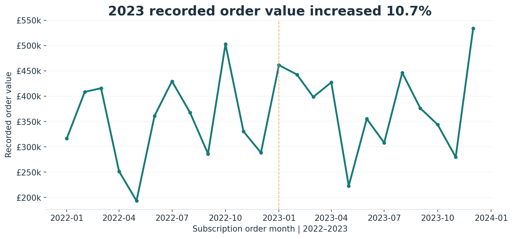
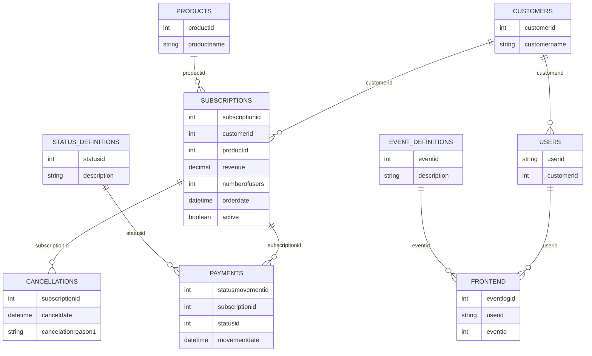
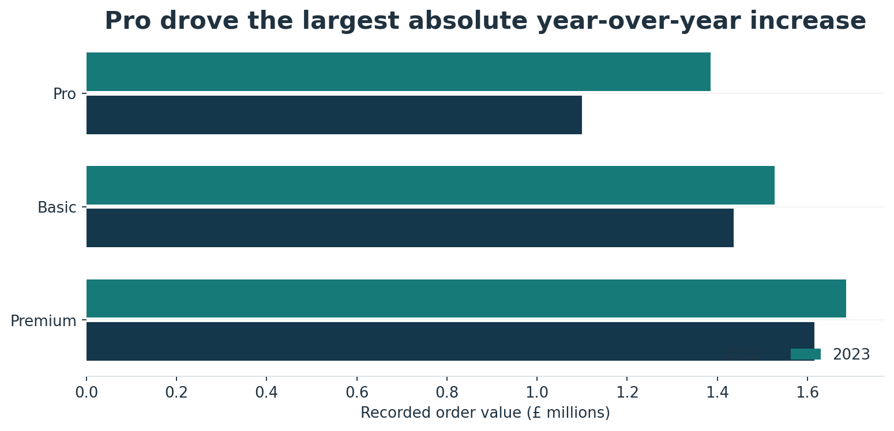
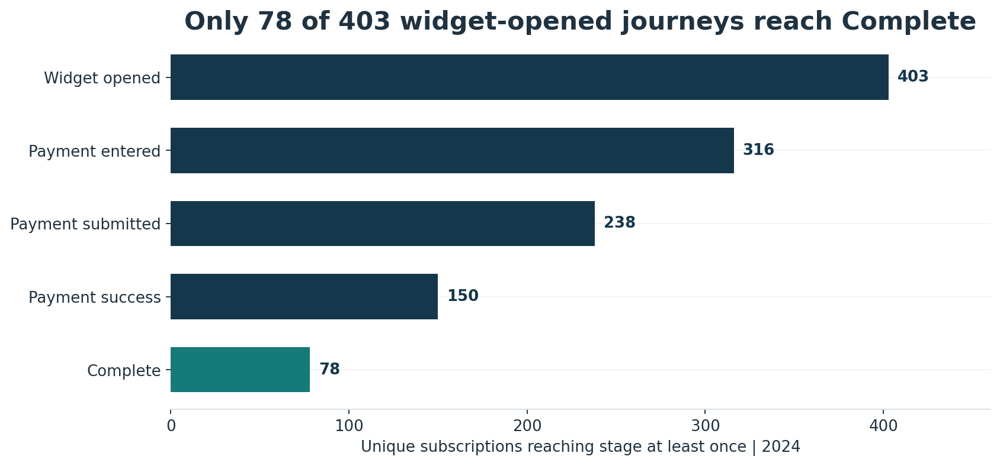
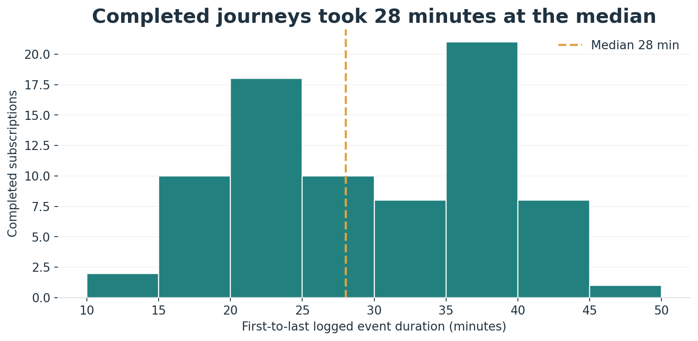
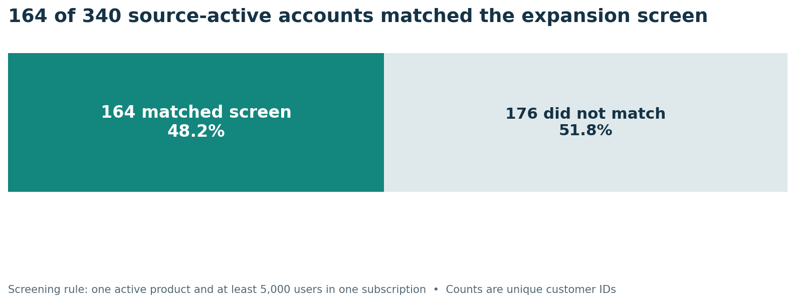
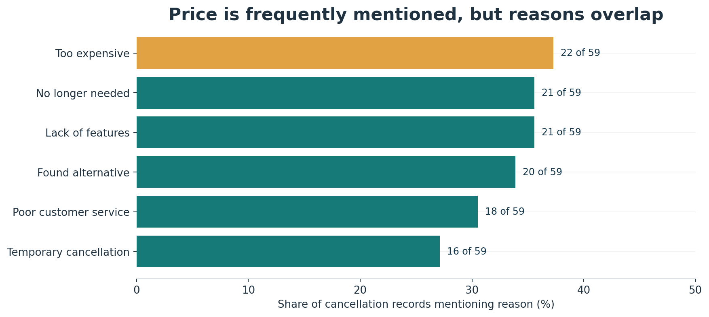
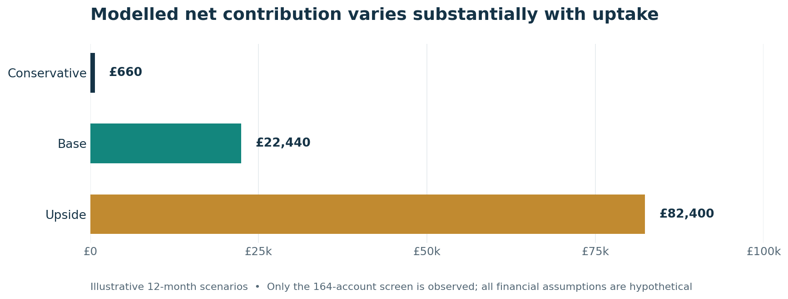

  <h1>CloudFlow | SaaS Commercial Performance Review</h1>
  
<strong>Revenue growth · Payment conversion · Customer expansion · Cancellation analysis</strong>

> **Executive takeaway:** CloudFlow's recorded subscription-order value grew **10.7%** in 2023, driven primarily by Pro. The clearest immediate issue, however, is payment measurement: only **78 of 403** widget-opened subscriptions have a logged *Complete* event, while the source records contain significant status inconsistencies. I would resolve those inconsistencies before calling the gap lost revenue.

**Explore the work:** [Executive presentation](docs/executive_brief.pdf) · [SQL analysis](sql/README.md) · [Supporting figures](docs/analysis_results.md)

---

# Client Background

## Business context

**CloudFlow** is a B2B software-as-a-service (SaaS) company used for this portfolio analysis. Its three subscription products are: **Basic, Pro and Premium**. Its commercial teams need to understand which products are contributing to growth, how customers progress through payment, and where there may be opportunities to grow or retain existing accounts.

The provided dataset contains subscription orders from **2022–2023**, payment-state events from **2024**, cancellation records spanning **2022–2024**, and supporting customer, user and product tables. These datasets support a useful performance review, but they do **not** provide complete recurring invoices, confirmed payment settlements or an account-level revenue history.

## Stakeholder brief

The case study is framed as an analysis for the **Product**, **Revenue Operations** and **Customer Success** teams. The aim is to support three decisions:

1. **Revenue mix:** Which subscription tier deserves closer investigation as a growth contributor?
2. **Checkout reliability:** Where should Product and Revenue Operations improve payment monitoring before making conversion claims?
3. **Customer value:** Which accounts warrant a targeted expansion review, and what should be tested before investing in outreach?

Cancellation reasons provide a fourth perspective on the retention questions those teams should investigate.

# North Star Metrics

CloudFlow's headline commercial measure in these records is **recorded subscription-order value**. It is a practical proxy for comparing the two order years.

| Commercial lens | Key metric | Observed result | Decision it informs |
|---|---|---|---|
| **Revenue performance** | Annual recorded subscription-order value | **£4.15M (2022) → £4.60M (2023), +10.72%** | Understand growth by product and order volume |
| **Product contribution** | Pro share of year-on-year order-value increase | **64.1%** of the £445,100 increase | Investigate Pro's acquisition, pricing and customer mix |
| **Payment conversion** | Subscriptions reaching *Complete* / subscriptions reaching *Widget Opened* | **78 / 403 = 19.35%**, 2024 | Resolve journey definition and instrument verified settlement |
| **Customer expansion** | Unique accounts matching the expansion screen | **164** of 340 source-active accounts | Validate shortlist for a controlled cross-sell pilot |
| **Retention diagnostics** | Cancellations mentioning price | **22 / 59 = 37.3%** | Understand reasons for leaving before changing pricing |

**How to interpret these metrics:** Order value is not verified recognised revenue; payment stages count distinct subscriptions, not payment attempts; the expansion list is a screening heuristic; and cancellation reasons can overlap. [Full KPI definitions](docs/metric_dictionary.md).

# Executive Summary

## Overview of findings

The recorded value of subscriptions increased by **£445,100**, from **£4,152,600** in 2022 to **£4,597,700** in 2023. **Pro** contributed **£285,400** (64.1%) of this increase and grew approximately **25.9%** year over year—faster than Basic or Premium. Nevertheless, higher order value is not evidence by itself of better retention or profitability.

At the same time, the 2024 payment log shows an unusually wide gap between subscriptions recorded at intermediate payment stages and those reaching *Complete*. Of **403** widget-opened subscriptions, **150** reached *Payment Success* but only **78** reached *Complete*. A further **119** subscriptions have a stored current status that differs from their latest payment event. These are reasons to investigate event definitions and data quality—not grounds to assume that 325 payments failed or that the business lost a specific amount of revenue.

A separate commercial screen identified **164 unique accounts** for Customer Success to review. Under clearly labelled hypothetical inputs, an expansion pilot could produce modelled 12-month net contribution between **£660 and £82,400**. These figures are scenarios, not observed sales or a forecast.

## Executive decisions

| Priority | What matters | Recommended next action |
|---|---|---|
| **1 · Establish trustworthy payment KPIs** | *Payment Success* and *Complete* diverge; status data is inconsistent | Agree terminal-state definitions and reconcile provider settlements with event logs |
| **2 · Test account expansion** | 164 accounts satisfy a transparent eligibility screen | Validate account needs, then test a relevant offer against a control group |
| **3 · Diagnose retention drivers** | Price and feature gaps recur in cancellation feedback | Interview relevant cohorts and test targeted responses rather than broad discounts |

# Data Structure & Initial Checks

## Dataset and reporting periods

The analysis uses **nine CSV tables**, covering subscriptions, products, customers, users, payment movements, payment-status definitions, cancellation reasons, frontend events and event definitions. The most useful analytical grains are **subscription-order row** for order value, **distinct subscription ID** for payment-stage reach, **customer ID** for expansion screening, and **cancellation record** for reported reasons.

| Domain | Core source tables | Period / grain |
|---|---|---|
| Subscription performance | `subscriptions`, `products`, `customers` | Orders dated 2022–2023 |
| Payment journey | `payments`, `status_definitions`, `subscriptions` | Logged payment movements in 2024 |
| Customer expansion | `subscriptions`, `customers` | Customer-ID screening from recorded active flags |
| Cancellations | `cancellations`, `subscriptions` | Cancellation records spanning 2022–2024 |
| Product usage context | `users`, `frontend`, `event_definitions` | Limited event coverage; not treated as complete adoption data |

## Logical entity relationship diagram

This diagram shows the intended **logical joins**, not enforced foreign-key constraints. The supplied customer table includes duplicate keys, so joins must be checked before aggregation.

## Initial quality checks

Before interpreting the results, I checked key uniqueness, referential links, event chronology and metric grain. Several findings affect how confidently the data can be used:

- **119 payment-status mismatches:** The stored subscription status differs from the latest logged movement.
- **Two duplicate customer dimension keys:** A naive dimension join can inflate account-level results.
- **Two cancellations dated before their subscription orders:** Cancellation timing is not completely reliable.
- **59 inactive subscriptions without a cancellation record:** The cancellation table is not a complete churn ledger.
- **Different time windows:** Orders from 2022–2023 cannot be used as matched monetary values for the 2024 payment funnel.

The complete exception counts and interpretation risks are documented in [Data Quality Audit](docs/data_quality_audit.md). The corresponding investigation queries are in [`sql/05_data_quality.sql`](sql/05_data_quality.sql).

# Insights Deep Dive

## 1. Revenue Performance — Pro accounts for 64% of the growth

### Annual growth and order composition

Recorded subscription-order value grew **10.72%** in 2023. The number of subscription-order rows rose from **284 to 299** (+5.3%), while average value per recorded row increased from approximately **£14,622 to £15,377** (+5.2%). Both the number and value of recorded orders contributed to the overall increase.

| Measure | 2022 | 2023 | Change |
|---|---:|---:|---:|
| Recorded order value | £4,152,600 | £4,597,700 | **+10.72%** |
| Subscription-order rows | 284 | 299 | **+5.28%** |
| Average value per row | £14,622 | £15,377 | **+5.16%** |

The monthly pattern fluctuates rather than rising uniformly. A fuller investigation should separate order count, average value and customer composition by month before making seasonality or demand claims.

### Which subscription tier drove the increase?

| Product | 2022 value | 2023 value | Absolute increase | YoY growth |
|---|---:|---:|---:|---:|
| Basic | £1,436,800 | £1,526,500 | £89,700 | +6.2% |
| **Pro** | **£1,099,900** | **£1,385,300** | **£285,400** | **+25.9%** |
| Premium | £1,615,900 | £1,685,900 | £70,000 | +4.3% |

**Commercial interpretation:** Pro is the strongest *growth contributor*, but Premium has the highest recorded value in both years. Those are different observations. Neither result shows product profitability, contract renewals or customer lifetime value.

**Action for Revenue Operations:** Decompose Pro's growth by new versus existing accounts, order size and any pricing or contract changes. Avoid reallocating investment solely on the basis of a higher growth rate.

**SQL evidence:** [`01_order_value_and_product.sql`](sql/01_order_value_and_product.sql) · [Annual totals](outputs/tables/yearly_revenue.csv) · [Product comparison](outputs/tables/product_yoy.csv)

## 2. Payment Journey — 19.35% reached the final logged stage

### Distinct subscription reach by stage

The payment log includes repeated events and possible retries. I therefore counted **distinct subscriptions ever reaching each stage**, rather than counting raw log rows or treating the highest status ID as the latest outcome.

| Logged stage | Subscriptions reaching stage | Share of widget openers |
|---|---:|---:|
| Widget Opened | 403 | 100.0% |
| Payment Entered | 316 | 78.4% |
| Payment Submitted | 238 | 59.1% |
| Payment Success | 150 | 37.2% |
| **Complete** | **78** | **19.35%** |

The figures describe **stage reach**, not a validated sequence of unique checkout attempts. A subscription can move through multiple attempts and repeat a status.

### Why the gap matters

**72** subscriptions have a *Payment Success* event but no *Complete* event. That difference could arise from missing final events, incomplete workflows or genuine unsuccessful transactions; the source does not establish which. Furthermore, **119** latest-event/current-status disagreements make it unsafe to infer a final business outcome from the stored status alone.

Among the **78** journeys that reached *Complete*, the median time between the first and last logged event was **28 minutes**, with the 90th percentile at **40.3 minutes**. This is elapsed event-log time, including any pauses or retries—not continuous user interaction time.

**Commercial interpretation:** The greatest immediate opportunity is *measurement reliability*. A genuine payment-conversion intervention should be prioritised only after the event model can distinguish abandoned attempts, settled payments and successful completion.

**Action for Product and Revenue Operations:** Introduce `payment_attempt_id`, agree terminal states, and reconcile logged successes to payment-provider settlement records. Then measure verified completion, error rates and recoverable value by attempt, device and error reason.

**SQL evidence:** [`02_payment_journey.sql`](sql/02_payment_journey.sql) · [Funnel table](outputs/tables/payment_funnel.csv) · [Journey detail](outputs/tables/payment_journeys.csv)

## 3. Customer Expansion — 164 accounts warrant review

### Identifying the shortlist

The screen starts with **340 unique accounts** holding at least one subscription marked active in the supplied data. From those accounts, **164** meet three rules:

- Their recorded subscriptions use **one distinct active product**.
- Their largest individual active subscription lists **at least 5,000 users**.
- Results are counted at **unique customer-ID grain**, preventing duplicate customer records from multiplying the list.

This is **48.2% of source-active accounts**, not 48.2% of potential buyers. The screen does not measure product fit, unused seats, available budget or willingness to adopt an additional offering.

### From a shortlist to a commercial experiment

I would ask Customer Success to verify account ownership, installed products and actual usage, then pilot a clearly defined offer with a comparable holdout group. The outcome should be **incremental contribution after outreach and fulfilment costs**, not just the number of accounts contacted.

**SQL evidence:** [`03_expansion_screen.sql`](sql/03_expansion_screen.sql) · [Screened candidate IDs](outputs/tables/expansion_candidates.csv)

## 4. Cancellations — price is common, but not the only reason

### Reasons reported in cancellation records

Of **59** recorded cancellations, **22 (37.3%)** mention price, **21 (35.6%)** mention missing features, and **21 (35.6%)** indicate the subscription was no longer needed.

These are **non-exclusive reason mentions**: each record can contain multiple answers. Percentages must not be added together, and they are not a subscription churn rate.

### What the findings suggest

Price is prominent, but the near-equal frequency of feature limitations and reduced need suggests that a blanket discount would be premature. Price concerns might reflect perceived product value, contract fit or competitive alternatives rather than price in isolation.

**Action for Customer Success:** Segment recent cancellations by product, account size and stated reasons; validate the primary cause through interviews. Test tailored responses and compare subsequent retention and contribution to a baseline or holdout.

**SQL evidence:** [`04_cancellation_mentions.sql`](sql/04_cancellation_mentions.sql) · [Reason counts](outputs/tables/cancellation_reasons.csv)

# Commercial Opportunity & Sensitivity Analysis

## Illustrative 12-month expansion business case

The **164 screened accounts** are observed from the supplied data. All other inputs in this model—including uptake, added annual value, margin and cost—are **assumptions**, not recorded transactions or achieved benefits.

| Model input | Conservative | Base case | Upside |
|---|---:|---:|---:|
| Screened accounts | 164 | 164 | 164 |
| Assumed offer uptake | 5% | 10% | 20% |
| Assumed incremental annual value per adopter | £2,000 | £3,000 | £4,000 |
| Assumed contribution margin | 65% | 70% | 75% |
| Assumed programme cost | £10,000 | £12,000 | £16,000 |
| **Modelled net contribution** | **£660** | **£22,440** | **£82,400** |

**Calculation:** `Screened accounts × uptake × incremental annual value × contribution margin − programme cost`.

This scenario illustrates the decision threshold, not an expected realised return. Before scaling, the team would need actual contract pricing, sales capacity, contribution margins and pilot conversion data. The scenarios above provide the sensitivity comparison; validate the inputs before using them for investment decisions.

# Recommendations & KPI Tracking Framework

## Prioritised recommendations

| Priority and owner | Evidence from the analysis | Recommended action | KPI to monitor |
|---|---|---|---|
| **1. Product + Revenue Operations** | 150 reached *Payment Success*; 78 reached *Complete*; 119 status mismatches | Audit event definitions, add attempt IDs and reconcile against settlements | Settled payment completion by attempt; unmatched event rate |
| **2. Customer Success + Sales** | 164 accounts meet the expansion screen | Validate account suitability and run a measured outreach pilot | Incremental contract value and contribution vs holdout |
| **3. Customer Success + Product** | Price 22/59; missing features 21/59; no longer needed 21/59 | Interview cancellation cohorts and test segmented interventions | Save rate, future retention and contribution after cost |
| **4. Revenue Operations + Finance** | Pro generated 64.1% of the observed value increase | Investigate growth by count, mix, pricing and cohort | Order volume, average order value and validated revenue by product |

## KPI definitions for ongoing monitoring

| KPI | Calculation | Why it matters |
|---|---|---|
| Recorded order-value growth | `(Current-period value / Prior-period value) − 1` | Tracks commercial movement within a consistent definition |
| Verified payment completion | `Settled payment attempts / eligible checkout attempts` | Requires provider settlement and attempt IDs; replaces stage-reach proxy |
| Expansion pilot uplift | `Change in treated accounts − comparable change in control accounts` | Separates intervention effects from existing customer demand |
| Net contribution | `Incremental contract value × contribution margin − programme cost` | Evaluates benefit after costs rather than headline revenue |
| Cancellation reason mix | `Distinct cancellations mentioning a reason / recorded cancellations` | Tracks reported friction without mislabelling it churn |

**Suggested sequence:** Establish payment measurement first; validate and run the expansion pilot next; use targeted cancellation research to guide the retention roadmap. [Detailed decision brief and execution plan](docs/business_case_and_roadmap.md).

# Assumptions & Caveats

1. **Currency:** All monetary figures are displayed in **GBP (£)** as the reporting convention for this portfolio. The source does not specify a currency and no foreign-exchange conversion was applied.
2. **Revenue terminology:** `subscriptions.revenue` is treated as recorded subscription-order value. The records cannot independently establish MRR, ARR, NRR, settlement revenue or recognised revenue.
3. **Different observation windows:** Subscription orders are from 2022–2023, while payment movements are from 2024. A contemporaneous payment-loss estimate cannot be derived by combining them.
4. **Payment interpretation:** Stage counts measure distinct subscriptions reaching each status at least once. They do not represent unique checkout attempts, ordered transitions or verified successful settlements.
5. **Source quality:** Duplicate customer keys, status disagreements and cancellation chronology exceptions affect certain analyses. Known issues are documented rather than silently corrected.
6. **Commercial modelling:** The expansion outcomes are hypothetical sensitivity scenarios, not realised savings, proven uplift or forecasts.
7. **Portfolio scope:** CloudFlow is a fictional business; the source records have been pseudonymised for publication. Redistributing the CSVs requires confirmation of the original dataset's publication rights.

# SQL Methodology & Supporting Files

My analysis is organised around **MySQL 8** scripts: year/month and product aggregation, payment-state reach, customer-level expansion screening, non-exclusive cancellation reasons, and data-quality checks. Supporting CSV exports and charts preserve the reported figures for review.

| Deliverable | Where to find it |
|---|---|
| Main SQL analysis and run order | [`sql/README.md`](sql/README.md) |
| SQL schema | [`sql/00_schema_mysql8.sql`](sql/00_schema_mysql8.sql) |
| SQL reconciliation checks | [`sql/07_reconciliation_checks.sql`](sql/07_reconciliation_checks.sql) |
| Source and prepared CSV tables | [`data/`](data/) |
| Charts and supporting result tables | [`outputs/`](outputs/) |
| Executive presentation | [`docs/executive_brief.pdf`](docs/executive_brief.pdf) |
| Metric dictionary | [`docs/metric_dictionary.md`](docs/metric_dictionary.md) |
| Data-quality audit | [`docs/data_quality_audit.md`](docs/data_quality_audit.md) |
| GitHub publishing instructions | [`docs/PUBLISHING.md`](docs/PUBLISHING.md) |

**Reproducibility note:** The included SQL is provided for independent execution using the prepared CSVs. It has **not** yet been run and reconciled on a live MySQL server in this release; do not interpret the saved results as proof of a successful database execution. Start with the [SQL setup guide](sql/README.md).

---

Case-study context: all names and business framing are illustrative. Findings reflect the provided dataset and stated metric definitions. The recommended interventions have not been implemented.
